# MASTER BLUEPRINT: CAREERPATH AI-ASSISTED MENTORING
**Dokumen Arsitektur Komprehensif, Flowchart Sistem, dan Panduan Desain UI/UX (Lo-Fi & Hi-Fi)**
*Versi: 1.0.0 — Tanggal Efektif: Oktober 2026*

---

## DAFTAR ISI
1. [BAB I: VISI SISTEM & ARSITEKTUR KONSEPTUAL](#bab-i-visi-sistem--arsitektur-konseptual)
2. [BAB II: ARSITEKTUR TEKNIS, DATABASE & AI ENGINE](#bab-ii-arsitektur-teknis-database--ai-engine)
3. [BAB III: KOMPILASI FLOWCHART SISTEM LENGKAP (MERMAID)](#bab-iii-kompilasi-flowchart-sistem-lengkap-mermaid)
4. [BAB IV: DESIGN SYSTEM & TOKENS UI/UX](#bab-iv-design-system--tokens-uiux)
5. [BAB V: DESAIN UI/UX LO-FI (WIREFRAME & STRUKTUR KOMPONEN)](#bab-v-desain-uiux-lo-fi-wireframe--struktur-komponen)
6. [BAB VI: DESAIN UI/UX HI-FI (SPESIFIKASI VISUAL & MOCKUP)](#bab-vi-desain-uiux-hi-fi-spesifikasi-visual--mockup)
7. [BAB VII: MATRIKS API & LOGIKA BISNIS](#bab-vii-matriks-api--logika-bisnis)
8. [BAB VIII: JAMINAN KEAMANAN & PRIVASI DATA](#bab-viii-jaminan-keamanan--privasi-data)

---

# BAB I: VISI SISTEM & ARSITEKTUR KONSEPTUAL

### 1.1 Latar Belakang & Filosofi "Evidence-Based Career Development"
Seringkali siswa dan mahasiswa mengalami disorientasi karier karena bimbingan karier konvensional hanya mengandalkan tes kepribadian sekali jalan atau saran intuitif tanpa data pembanding yang terukur. 

**CareerPath AI-Assisted Mentoring** dibangun di atas filosofi **Evidence-Based Competency**:
1. **Bukan Sekadar Chatbot**: CareerPath mengintegrasikan asesmen psikometrik terstruktur, pemetaan profesi berbasis taksonomi, rencana aksi individual (*Individual Development Plan*), dan bukti artefak nyata.
2. **Klaim vs Bukti vs Validasi**: Membedakan secara tegas antara kompetensi yang baru sebatas "dinyatakan" (*Claimed*), yang telah didukung portofolio (*Evidence-Backed*), dan yang telah disahkan oleh profesional/mentor (*Mentor-Validated*).
3. **Human-in-the-Loop**: Kecerdasan Buatan (AI) bertindak sebagai akselerator sintesis konteks dan penyusun rekomendasi draf, sedangkan guru BK, dosen, dan praktisi industri memegang otoritas validasi akhir.

### 1.2 Pilar Sistem & Prinsip Desain
- **Personalization**: Rekomendasi karier beradaptasi dengan jenjang pendidikan, minat RIASEC, dan kecepatan progres pengguna.
- **Explainability**: Setiap rekomendasi karier wajib menyajikan rincian pembobotan yang jelas (*Interest Match 40%*, *Skill Match 35%*, *Education Match 25%*).
- **User Autonomy**: Pengguna memegang kendali penuh atas pemilihan target karier dan publikasi portofolio.
- **Privacy & Security**: Perlindungan ekstra bagi siswa di bawah umur, minimasi data ke API LLM eksternal, dan penegakan otorisasi *least privilege*.

### 1.3 Taksonomi Pengguna & Matriks Hak Akses (RBAC)

| Peran (Role) | Karakteristik Pengguna | Hak Akses Utama | Batasan Ketat |
| :--- | :--- | :--- | :--- |
| **STUDENT** | Siswa SMP, SMA/SMK, Mahasiswa, Tingkat Akhir | Mengerjakan asesmen, memilih target karier, mengelola IDP, mengunggah portofolio, chat AI Mentor, menyimpan peluang. | Hanya dapat mengakses data pribadi miliknya; tidak dapat memvalidasi sendiri kompetensinya. |
| **MENTOR** | Guru BK, Dosen Wali, Praktisi Industri | Melihat roster mentee yang sah ditugaskan, memeriksa antrean review evidence, memberi feedback IDP, membuat tugas berbatas waktu. | Dilarang mengakses profil mentee yang tidak ditugaskan; tidak dapat mengubah hasil asesmen siswa. |
| **INSTITUTION ADMIN** | Pimpinan Sekolah / Kampus (Wakasek, Dekanat) | Melihat analitik agregat kematangan siswa, progres rata-rata IDP, tren profesi, dan kesenjangan kurikulum. | Tidak berhak membaca percakapan privat AI atau dokumen privat mentee tanpa izin. |
| **PLATFORM ADMIN** | Operator Platform / Superadmin | Mengelola katalog taksonomi profesi, definisi asesmen, katalog peluang, dan memantau live audit log sistem. | Akses diaudit secara otomatis di tabel `audit_logs`. |

### 1.4 Matriks 4 Tahap Perjalanan Karier & Career Maturity

```
+---------------------------------------------------------------------------------------+
|                                 CAREER MATURITY JOURNEY                               |
+---------------------------+---------------------------+-------------------------------+
|  Level / Tahap            |  Target Pengguna          |  Fokus & Luaran Utama         |
+---------------------------+---------------------------+-------------------------------+
|  L1: EXPLORE              |  Siswa SMP / MTs          |  • Eksplorasi minat luas      |
|                           |                           |  • Pengenalan spektrum profesi|
|                           |                           |  • Pemahaman korelasi studi   |
+---------------------------+---------------------------+-------------------------------+
|  L2: PLAN                 |  Siswa SMA / SMK / MA     |  • Penentuan jurusan/fakultas |
|                           |                           |  • Perbandingan jalur studi   |
|                           |                           |  • Penetapan target karier    |
+---------------------------+---------------------------+-------------------------------+
|  L3: DEVELOP              |  Mahasiswa                |  • Analisis skill gap nyata   |
|                           |                           |  • Eksekusi IDP aktif         |
|                           |                           |  • Pengumpulan bukti portofolio|
+---------------------------+---------------------------+-------------------------------+
|  L4: READY                |  Tingkat Akhir / Lulusan  |  • Skill Passport tervalidasi |
|                           |                           |  • Portofolio & CV siap kerja |
|                           |                           |  • Match magang / beasiswa    |
+---------------------------+---------------------------+-------------------------------+
```

### 1.5 Formula Deterministik Career Maturity Index
Kematangan karier dihitung berdasarkan bukti progres objektif, bukan usia biologis:

$$\text{Maturity Score} = (0.25 \times S_{\text{assess}}) + (0.25 \times S_{\text{target}}) + (0.30 \times S_{\text{idp}}) + (0.20 \times S_{\text{evidence}})$$

- **$S_{\text{assess}}$ (25 poin)**: Telah menuntaskan asesmen terstandar Holland RIASEC.
- **$S_{\text{target}}$ (25 poin)**: Telah menetapkan minimal 1 target karier aktif.
- **$S_{\text{idp}}$ (30 poin)**: Dihitung proporsional dari persentase penyelesaian aktivitas IDP aktif.
- **$S_{\text{evidence}}$ (20 poin)**: Memiliki minimal bukti portofolio yang terunggah (10 poin) dan telah divalidasi mentor (20 poin).

**Klasifikasi Level:**
- `Score < 25` $\rightarrow$ **L1: EXPLORE**
- `25 <= Score < 50` $\rightarrow$ **L2: PLAN**
- `50 <= Score < 75` $\rightarrow$ **L3: DEVELOP**
- `Score >= 75` $\rightarrow$ **L4: READY**

---

# BAB II: ARSITEKTUR TEKNIS, DATABASE & AI ENGINE

### 2.1 Arsitektur Aplikasi (Layered Modular Monolith)
CareerPath mengadopsi arsitektur Modular Monolith menggunakan **Next.js (App Router)** dan **TypeScript**, memisahkan domain secara ketat:

```
+------------------------------------------------------------------------------------+
|                             PRESENTATION LAYER (Next.js)                           |
|   App Router Pages: /dashboard, /assessments, /career-map, /development-plans,     |
|                     /portfolio, /opportunities, /ai-mentor, /mentoring, /admin     |
|   Components: Navbar, Footer, MaturityBadge, Forms, Interactive Modals             |
+------------------------------------------------------------------------------------+
                                         │
+------------------------------------------------------------------------------------+
|                              APPLICATION & ROUTE LAYER                             |
|   Next.js Dynamic Route Handlers: /api/auth/*, /api/assessments/*, /api/careers/*  |
|                                   /api/idp/*, /api/portfolio/*, /api/ai/*          |
|   Session & Cookie Enforcer: HttpOnly Token JWT, RBAC Middleware Guards            |
+------------------------------------------------------------------------------------+
                                         │
+------------------------------------------------------------------------------------+
|                                DOMAIN SERVICE LAYER                                |
|   AuthService         AssessmentService     CareerMapService      IdpService       |
|   PortfolioService    OpportunityService    MentoringService      AnalyticsService |
|   AuditService        AiService (Multi-Provider Context Injector)                  |
+------------------------------------------------------------------------------------+
                        │                                             │
+-----------------------------------------------+   +--------------------------------+
|               DATA ACCESS LAYER               |   |        AI PROVIDER ADAPTER     |
|   Persistent Relational Engine:               |   |  Primary: Google Gemini API    |
|   SQLite (@libsql/client) / data/careerpath.db|   |  Secondary: OpenAI API         |
|   Cloud Parity: PostgreSQL Supabase DDL + RLS |   |  Fallback: Deterministic       |
|   34 Normalized Relational Tables             |   |            Heuristic Simulator |
+-----------------------------------------------+   +--------------------------------+
```

### 2.2 Arsitektur Data Relasional (34 Tabel)
Database dirancang ternormalisasi (3NF) dengan foreign key cascades, unique constraints, dan indexing pada kolom pencarian:
1. **Identitas & Organisasi**: `users`, `profiles`, `institutions`, `institution_memberships`, `mentor_assignments`, `user_consents`.
2. **Asesmen Psikometrik**: `assessments`, `assessment_versions`, `assessment_questions`, `assessment_options`, `assessment_attempts`, `assessment_answers`, `assessment_results`.
3. **Karier & Taksonomi Kompetensi**: `occupations`, `competencies`, `occupation_competencies`, `career_paths`, `career_path_steps`, `career_recommendations`, `saved_careers`.
4. **IDP & Aktivitas Pengembangan**: `development_plans`, `development_goals`, `development_activities`, `activity_competencies`, `activity_progress_logs`, `learning_resources`.
5. **Portofolio & Skill Passport**: `portfolios`, `portfolio_items`, `evidence_files`, `competency_evidence`, `evidence_reviews`, `ai_feedback_records`.
6. **Katalog Peluang & Matching**: `opportunities`, `opportunity_requirements`, `opportunity_competencies`, `saved_opportunities`.
7. **AI & Bimbingan Manusia**: `ai_conversations`, `ai_messages`, `mentoring_tasks`, `mentoring_discussions`, `mentoring_comments`.
8. **Tata Kelola & Keamanan**: `notifications`, `audit_logs`.

### 2.3 Desain AI Multi-Provider & Offline Fallback Engine
Untuk mencegah ketergantungan pada satu vendor dan menjamin aplikasi tidak pernah mengalami crash 500 saat offline atau kuota API habis:
1. **Interface Terpadu**: `callAiProvider(prompt, context)` mengecek variabel lingkungan `GEMINI_API_KEY` lalu `OPENAI_API_KEY`.
2. **Context Builder**: Menyaring data pengguna yang relevan (jenjang pendidikan, target profesi, *skill gap*, progres IDP) tanpa membocorkan identitas privat pengguna lain.
3. **Guardrails**: Prompt instruksi melarang halusinasi angka/sertifikasi fiktif, melarang klaim diagnostik psikologis, dan menolak injeksi instruksi dari teks pengguna.
4. **Heuristic Simulation Fallback**: Jika request API eksternal gagal atau tidak terkonfigurasi, sistem secara otomatis mengaktifkan modul inferensi berbasis aturan deterministik lokal.

---

# BAB III: KOMPILASI FLOWCHART SISTEM LENGKAP (MERMAID)

Berikut adalah diagram alir (*flowcharts*) lengkap untuk seluruh modul inti sistem:

### 3.1 Flowchart 1: End-to-End User Journey (L1–L4)
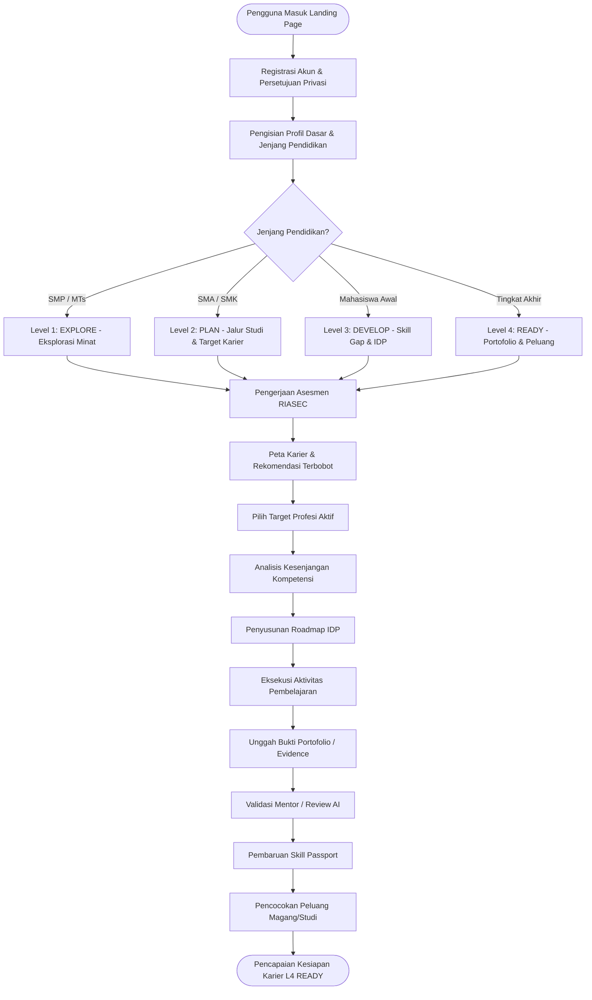

---

### 3.2 Flowchart 2: Alur Registrasi, Onboarding & Consent
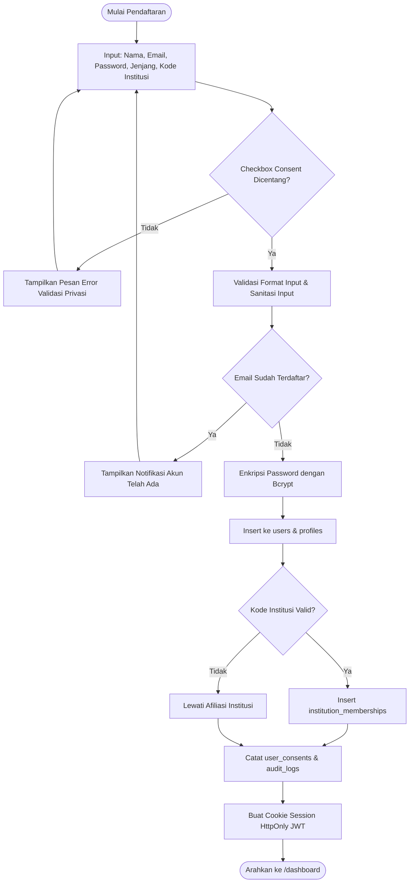

---

### 3.3 Flowchart 3: Modul ASSESS (Pengerjaan & Scoring Holland RIASEC)
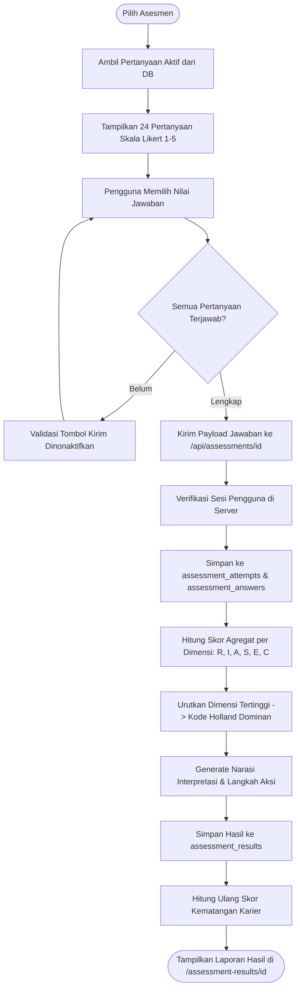

---

### 3.4 Flowchart 4: Modul MAP (Rekomendasi Terukur & Analisis Skill Gap)
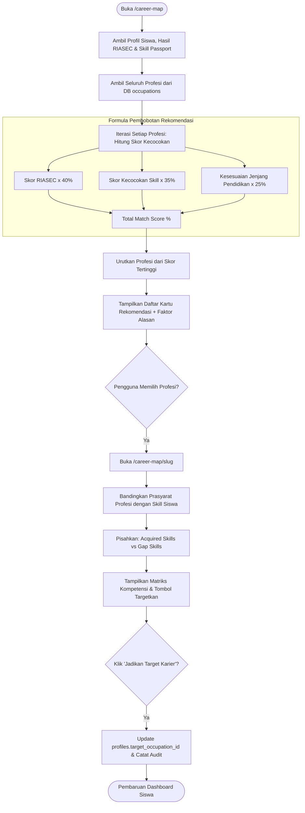

---

### 3.5 Flowchart 5: Modul DEVELOP (IDP Lifecycle & Tracking Progress)
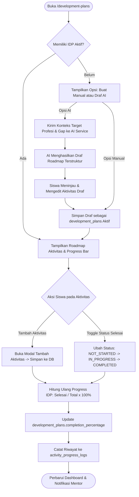

---

### 3.6 Flowchart 6: Modul PROVE (Portofolio & 3-Tier Skill Passport)
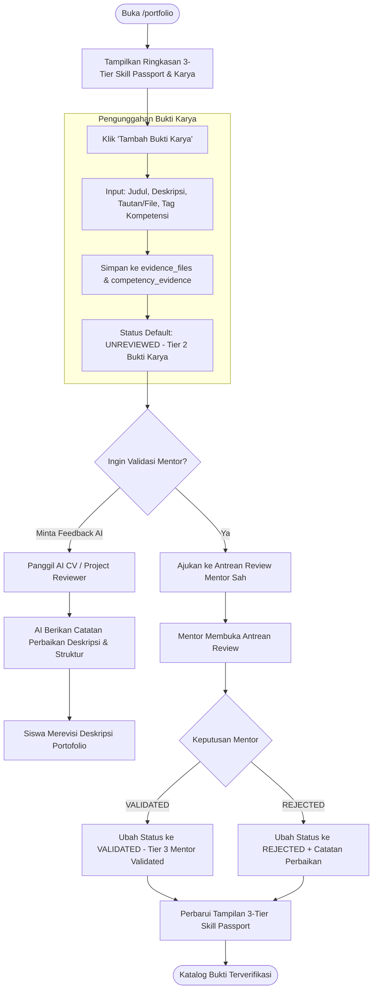

---

### 3.7 Flowchart 7: Modul MATCH (Pencocokan Peluang)
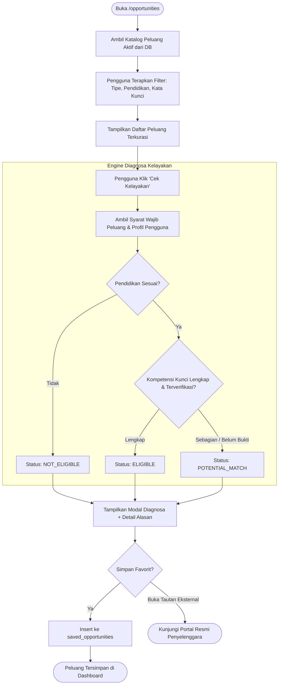

---

### 3.8 Flowchart 8: AI Career Mentor (Konteks, Guardrails & Fallback)
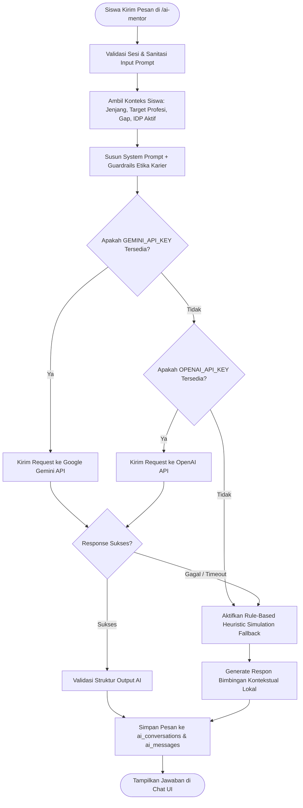

---

### 3.9 Flowchart 9: Modul HUMAN MENTORING (Bimbingan Asinkron)
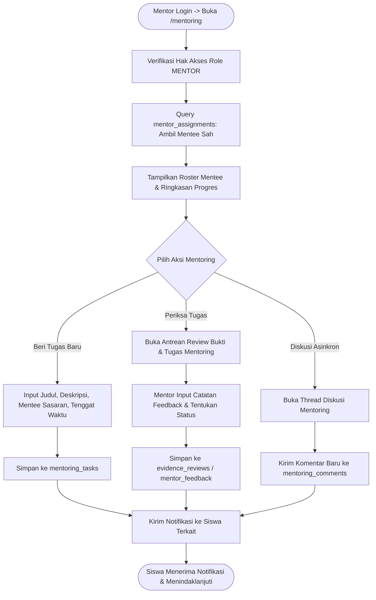

---

### 3.10 Flowchart 10: Career Analytics & Dashboard Institusi
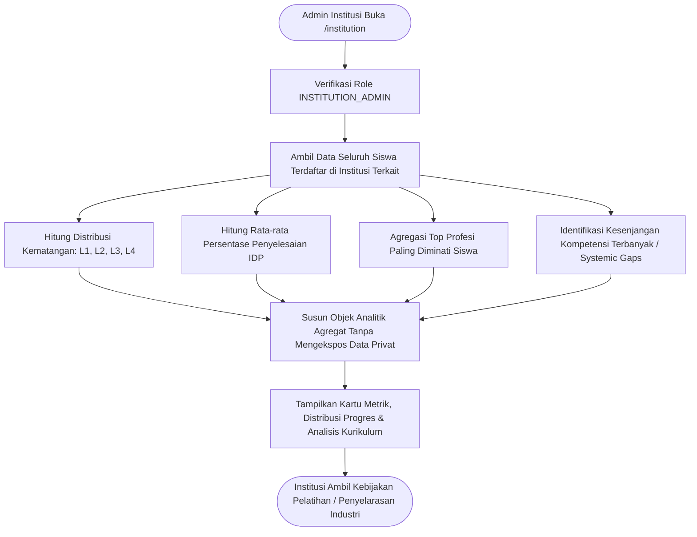

---

### 3.11 Flowchart 11: Tata Kelola Platform & Audit Log Trail
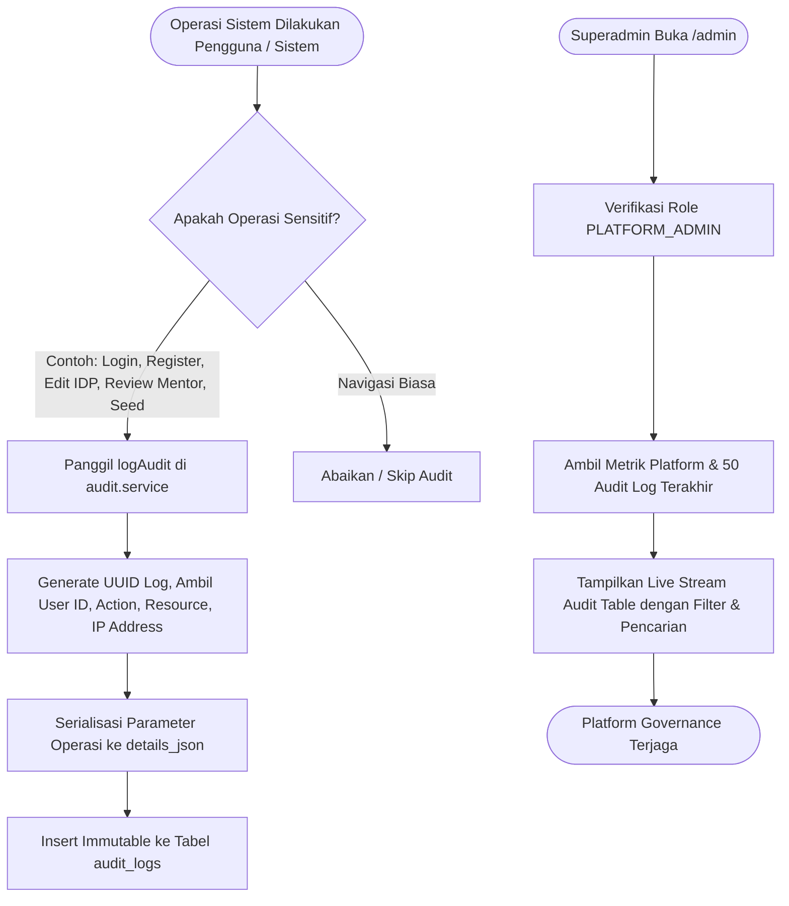

---

# BAB IV: DESIGN SYSTEM & TOKENS UI/UX

### 4.1 Prinsip Desain & Visual Direction (Editorial High-End Aesthetic)
- **Aesthetic**: *Clean Editorial Modernism with Ruby/Crimson Accents* dipadukan dengan tipografi hitam berani, kanvas putih/stone yang bersih, kartu dengan border halus, dan pill buttons.
- **Strict Zero-Emoji Rule**: Dilarang keras menggunakan karakter emoji Unicode di seluruh antarmuka sistem. Seluruh indikator visual, status, penanda persona, dan tombol WAJIB menggunakan asset ikon vektor terstandar (**Lucide Icons / SVG**).
- **Action-Oriented**: Setiap kartu dan metrik menyertakan penanda tindakan konkret (*Pills CTA* seperti "Start Free ->", "Learn More ->", "Lihat Skill Gap ->").
- **No Decoration Clutter**: Menghindari hiasan tidak bermakna; mengutamakan kejelasan hierarki tipografi dan keterbacaan data.

### 4.2 Palet Warna & Semantic Tokens (Editorial Theme)

```
+---------------------------------------------------------------------------------------+
|                                    COLOR PALETTE                                      |
+---------------------+-------------------+---------------------+-----------------------+
| Token               | Hex Code          | Penggunaan          | Emosi / Makna         |
+---------------------+-------------------+---------------------+-----------------------+
| Brand Primary       | #DC2626 (Red)     | Aksen utama, CTA    | Berani, terarah, jelas|
| Brand Secondary     | #18181B (Zinc 900)| Tipografi & tombol  | Otoritas, editorial   |
| Accent Crimson      | #BE123C (Rose 700)| Badge sorotan, pill | Tajam, premium        |
| Success Emerald     | #059669 (Emerald) | Validasi, tier 3    | Tervalidasi, selesai  |
| Warning Amber       | #D97706 (Amber)   | Bukti karya, tier 2 | Dalam pengerjaan      |
| Neutral Stone 50    | #FAFAFA (Stone)   | Latar belakang kanvas| Bersih, lapang       |
| Surface Card White  | #FFFFFF (White)   | Latar kartu modul   | Kontras optimal       |
| Dark Base           | #09090B (Zinc 950)| Mode gelap kanvas   | Kontras tinggi        |
| Border Line         | #E4E4E7 (Zinc 200)| Garis pembatas kartu| Presisi, rapi         |
+---------------------+-------------------+---------------------+-----------------------+
```

### 4.3 Skala Tipografi
- **Font Utama**: `Geist Sans`, alternatif: `Inter`, `system-ui`.
- **Font Monospace**: `Geist Mono` untuk kode, hash audit log, dan ID.
- **Heading 1**: 24px - 30px (Desktop), 20px - 24px (Mobile), font-bold, tracking-tight.
- **Heading 2**: 18px - 20px, font-bold.
- **Body Regular**: 14px, line-height 1.6, text-slate-600 / text-slate-300.
- **Caption / Meta**: 11px - 12px, font-medium, tracking-wider uppercase.

### 4.4 Aturan Responsivitas & Viewport Breakpoints
- **Mobile (360px – 640px)**: 
  - Layout 1 kolom penuh.
  - Sidebar diubah menjadi *slide-over mobile drawer*.
  - Tabel kompleks diubah menjadi format kartu vertikal.
  - Target sentuhan (*touch target*) minimal **44px $\times$ 44px**.
  - Bebas dari *horizontal overflow*.
- **Tablet (641px – 1024px)**: Grid 2 kolom, navigasi ringkas.
- **Desktop ($\ge$ 1025px)**: Grid 3 hingga 6 kolom, bilah navigasi penuh, split-screen pada peta karier dan review.

---

# BAB V: DESAIN UI/UX LO-FI (WIREFRAME & STRUKTUR KOMPONEN)

Berikut adalah wireframe tekstual terstruktur (*low-fidelity*) yang mendefinisikan hierarki elemen untuk seluruh halaman utama:

### 5.1 Wireframe: Landing Page (`/`)
```
+-----------------------------------------------------------------------------------+
| [Logo CareerPath]   [Karier]  [Peluang]  [Tentang]        [Login] [Mulai Gratis]  |
+-----------------------------------------------------------------------------------+
|                                                                                   |
|     [Badge: Platform Bimbingan Karier Berbasis Data & AI Mentoring]               |
|                                                                                   |
|     TEMUKAN POTENSI. RENCANAKAN KARIER. BUKTIKAN KOMPETENSI.                      |
|     Ubah minat menjadi rencana aksi konkret dengan bimbingan AI & mentor manusia. |
|                                                                                   |
|          [ Tombol: Mulai Asesmen RIASEC ]    [ Tombol: Jelajahi Peta Karier ]     |
|                                                                                   |
+-----------------------------------------------------------------------------------+
|  4 TAHAP PERJALANAN KARIER:                                                       |
|  +-----------------+  +-----------------+  +-----------------+  +-----------------+
|  | L1: EXPLORE     |  | L2: PLAN        |  | L3: DEVELOP     |  | L4: READY       |
|  | Siswa SMP       |  | Siswa SMA/SMK   |  | Mahasiswa       |  | Tingkat Akhir   |
|  | Eksplorasi minat|  | Jurusan & Studi |  | IDP & Skill Gap |  | Portofolio Kerja|
|  +-----------------+  +-----------------+  +-----------------+  +-----------------+
+-----------------------------------------------------------------------------------+
|  6 MODUL UTAMA INTEGRASI (ASSESS, MAP, DEVELOP, PROVE, MATCH, MENTOR)            |
+-----------------------------------------------------------------------------------+
```

---

### 5.2 Wireframe: Student Dashboard (`/dashboard`)
```
+-----------------------------------------------------------------------------------+
| [Fast Demo Switcher Bar: Budi(SMP) | Siti(SMA) | Reza(Mhs) | Dewi(Akhir) | Sarah] |
+-----------------------------------------------------------------------------------+
| [Navbar: Dashboard | Asesmen | Peta Karier | IDP | Portofolio | Peluang | AI Mentor]|
+-----------------------------------------------------------------------------------+
|                                                                                   |
|  Halo, Reza Kurniawan!                     [Badge: L3 DEVELOP - Skor 66/100]      |
|  Mahasiswa Teknik Informatika · Institut Teknologi Bandung                        |
|                                                                                   |
|  +--------------------------------+  +------------------------------------------+ |
|  | TARGET KARIER AKTIF            |  | INDIVIDUAL DEVELOPMENT PLAN (IDP)        | |
|  | Profesi: Data Scientist        |  | "Roadmap Data Scientist 2026"            | |
|  | Kecocokan: 92% (RIASEC: IR)    |  | Progres: [===========>       ] 66%       | |
|  | Gap: Deep Learning, Cloud MLOps|  | 2 dari 3 aktivitas terselesaikan         | |
|  | [ Lihat Detail Peta Karier > ] |  | [ Buka Roadmap IDP Lengkap > ]           | |
|  +--------------------------------+  +------------------------------------------+ |
|                                                                                   |
|  +------------------------------------------------------------------------------+ |
|  | 3-TIER SKILL PASSPORT SUMMARY                                                | |
|  | [ Klaim: 1 Kompetensi ]   [ Bukti: 1 Kompetensi ]   [ Validasi: 1 Kompetensi]| |
|  +------------------------------------------------------------------------------+ |
|                                                                                   |
|  +-----------------------------------------+  +---------------------------------+ |
|  | AKTIVITAS HARUS DIKERJAKAN SELANJUTNYA  |  | NOTIFIKASI & FEEDBACK MENTOR    | |
|  | [ ] Deploy Model ke Cloud Run (Tinggi)  |  | "Bagus, perbaiki dokumentasi..."| |
|  | Tenggat: 30 November 2026               |  | Oleh: Sarah Wulandari, M.Psi.   | |
|  +-----------------------------------------+  +---------------------------------+ |
+-----------------------------------------------------------------------------------+
```

---

### 5.3 Wireframe: Lembar Asesmen Holland RIASEC (`/assessments/[id]`)
```
+-----------------------------------------------------------------------------------+
| [ <- Kembali ke Katalog ]                      Asesmen Minat Karier Holland RIASEC|
+-----------------------------------------------------------------------------------+
| Progres Pengerjaan: [===================>             ] Pertanyaan 12 dari 24     |
|                                                                                   |
| +-------------------------------------------------------------------------------+ |
| | NO. 12  [Dimensi: INVESTIGATIVE]                                              | |
| | "Saya senang menganalisis data, memecahkan masalah logika, dan mencari pola." | |
| |                                                                               | |
| | ( ) 1 - Sangat Tidak Suka                                                     | |
| | ( ) 2 - Tidak Suka                                                            | |
| | ( ) 3 - Netral                                                                | |
| | (o) 4 - Suka                                                                  | |
| | ( ) 5 - Sangat Suka                                                           | |
| +-------------------------------------------------------------------------------+ |
|                                                                                   |
| [ <- Pertanyaan Sebelumnya ]                        [ Simpan & Lanjutkan -> ]     |
|                                                     [ Kirim Jawaban Akhir ]       |
+-----------------------------------------------------------------------------------+
```

---

### 5.4 Wireframe: Peta Karier & Skill Gap (`/career-map/[slug]`)
```
+-----------------------------------------------------------------------------------+
| [ <- Kembali ke Peta Karier ]                  Katalog Profesi > Data Scientist   |
+-----------------------------------------------------------------------------------+
| DATA SCIENTIST                          [Kecocokan Anda: 92%] [Holland Code: IR]  |
| Deskripsi profesi, prospek gaji (12 - 25 Juta/bln), dan aktivitas eksplorasi.     |
|                                               [ Tombol: Jadikan Target Karier ]   |
+-----------------------------------------------------------------------------------+
| JALUR PENDIDIKAN RELEVAN:                                                         |
| [ S1 Teknik Informatika / Sains Data ] -> [ Sertifikasi AI/ML ] -> [ Karir ]      |
+-----------------------------------------------------------------------------------+
| ANALISIS KESENJANGAN KOMPETENSI (SKILL GAP):                                      |
|                                                                                   |
| KOMPETENSI SUDAH DIMILIKI (ACQUIRED):                                             |
| [✓] Python Programming (Tervalidasi Mentor)                                       |
| [✓] SQL & Relational Database (Didukung Bukti Portofolio)                         |
|                                                                                   |
| KOMPETENSI PERLU DIKEMBANGKAN (GAP):                                              |
| [!] Deep Learning & PyTorch               - Prioritas: KRITIS (Expected: Advanced)|
| [!] Cloud Deployment & MLOps               - Prioritas: PENTING (Expected: Inter)  |
|                                                                                   |
| [ Tombol: Buat Rencana Belajar (IDP) untuk Menutup Gap Ini Bersama AI > ]         |
+-----------------------------------------------------------------------------------+
```

---

### 5.5 Wireframe: Portofolio & 3-Tier Skill Passport (`/portfolio`)
```
+-----------------------------------------------------------------------------------+
| PORTOFOLIO & 3-TIER SKILL PASSPORT            [ + Tambah Proyek / Bukti Baru ]    |
+-----------------------------------------------------------------------------------+
| RINGKASAN TIER PASPOR KEAHLIAN:                                                   |
| +-------------------------+ +-------------------------+ +-----------------------+ |
| | ⚪ TIER 1: KLAIM MANDIRI| | 🟡 TIER 2: BUKTI KARYA  | | 🟢 TIER 3: TERVALIDASI| |
| | Machine Learning Fund.  | | SQL & Relational DB     | | Python Programming    | |
| | Status: Dinyatakan mhs  | | Terlampir: GitHub Repo  | | Validator: Sarah (BK) | |
| +-------------------------+ +-------------------------+ +-----------------------+ |
+-----------------------------------------------------------------------------------+
| DAFTAR PROYEK & ARTEFAK PORTOFOLIO:                                               |
| +-------------------------------------------------------------------------------+ |
| | E-Commerce Customer Analytics Project             [Privasi: Publik] [Aksi: ..]| |
| | Analisis churn pelanggan 10.000 transaksi menggunakan Python dan SQL.         | |
| | Tautan: github.com/reza/ecommerce-analytics                                   | |
| | Feedback AI: "Deskripsi kuantitatif baik, tambahkan metrik dampak bisnis."    | |
| | [ Minta Review Mentor BK ]     [ Simulasi Wawancara AI untuk Proyek Ini ]     | |
| +-------------------------------------------------------------------------------+ |
+-----------------------------------------------------------------------------------+
```

---

### 5.6 Wireframe: AI Career Mentor (`/ai-mentor`)
```
+-----------------------------------------------------------------------------------+
| AI CAREER MENTOR                                   [Status AI: Online (Gemini)]   |
| Bimbingan karier kontekstual berdasarkan profil Anda (Target: Data Scientist)     |
+-----------------------------------------------------------------------------------+
| Quick Prompt Chips:                                                               |
| [ Analisis skill gap saya ]  [ Buatkan draf IDP ]  [ Review deskripsi proyek ]    |
+-----------------------------------------------------------------------------------+
| (AI) Halo Reza! Berdasarkan target kariermu sebagai Data Scientist, kamu sudah    |
|      menguasai Python dan SQL, namun masih memerlukan Deep Learning & MLOps.      |
|      Apakah ingin kita buatkan jadwal belajar minggu ini?                         |
|                                                                                   |
| (You) Analisis skill gap saya untuk Data Scientist                                |
|                                                                                   |
| (AI) Baik! Berikut perincian 2 skill gap utamamu:                                 |
|      1. Deep Learning: Mulai dari konsep neural network dasar.                    |
|      2. Cloud MLOps: Pelajari Docker dan deploy model sederhana.                 |
+-----------------------------------------------------------------------------------+
| [ Ketik pertanyaan atau minta bimbingan karier...                       ] [Kirim] |
+-----------------------------------------------------------------------------------+
```

---

### 5.7 Wireframe: Workspace Human Mentoring (`/mentoring`)
```
+-----------------------------------------------------------------------------------+
| WORKSPACE GURU BK & MENTOR INDUSTRI (Sarah Wulandari, M.Psi.)                     |
+-----------------------------------------------------------------------------------+
| DAFTAR MENTEE ANDA (2 Siswa Ditugaskan):                                          |
| • Dewi Anggraini (Tingkat Akhir - L4 READY)   - Status: Siap Masuk Kerja          |
| • Reza Kurniawan (Mahasiswa - L3 DEVELOP)      - Status: Progres IDP 66%           |
+-----------------------------------------------------------------------------------+
| ANTREAN REVIEW BUKTI KOMPETENSI (1 Menunggu Review):                              |
| +-------------------------------------------------------------------------------+ |
| | Mentee: Reza Kurniawan · Bukti: Repositori Analitik E-Commerce                | |
| | Tag Kompetensi: SQL & Relational Database                                     | |
| | [ Input Catatan Feedback Mentor...                                          ] | |
| | [ Tombol: ✓ Validasi Kompetensi (Tier 3) ]   [ Tombol: X Minta Perbaikan ]    | |
| +-------------------------------------------------------------------------------+ |
+-----------------------------------------------------------------------------------+
| TUGAS MENTORING BERBATAS WAKTU:                     [ + Buat Tugas Baru Mentee ]  |
| • "Perbaiki Dokumentasi Readme Repositori" -> Mentee: Reza -> Status: IN_PROGRESS|
+-----------------------------------------------------------------------------------+
```

---

### 5.8 Wireframe: Platform Admin Control Center (`/admin`)
```
+-----------------------------------------------------------------------------------+
| PUSAT KENDALI PLATFORM & AUDIT LOG SISTEM                   [ Perbarui Data (R) ] |
+-----------------------------------------------------------------------------------+
| RINGKASAN METRIK SISTEM:                                                          |
| [ 7 Pengguna ]  [ 10 Profesi ]  [ 1 Asesmen ]  [ 6 Peluang ]  [ 4 IDP ]  [ 8 AI ] |
+-----------------------------------------------------------------------------------+
| TAUTAN TATA KELOLA KATALOG:                                                       |
| [ Katalog Profesi ]   [ Definisi Asesmen ]   [ Katalog Peluang ]   [ Institusi ]  |
+-----------------------------------------------------------------------------------+
| TABEL AUDIT LOG AKTIVITAS SISTEM (IMMUTABLE):                                     |
| [ Cari Aksi / User...          ] [ Filter Aksi: Semua / Login / IDP / Review ]    |
| +--------------------+------------------+-------------+------------+------------+ |
| | Waktu & IP         | Aktor            | Aksi        | Resource   | Detail     | |
| +--------------------+------------------+-------------+------------+------------+ |
| | 11/10/2026 01:45   | Reza Kurniawan   | UPDATE_IDP  | activities | act-02     | |
| | 11/10/2026 01:40   | Sarah Wulandari  | REVIEW_EVID | evidence   | ev-01 val  | |
| | 11/10/2026 01:30   | Budi Santoso     | SUBMIT_TEST | attempt    | RIASEC att | |
| +--------------------+------------------+-------------+------------+------------+ |
+-----------------------------------------------------------------------------------+
```

---

# BAB VI: DESAIN UI/UX HI-FI (SPESIFIKASI VISUAL & MOCKUP)

### 6.1 Spesifikasi Visual High-Fidelity
- **Kaca Transparan (Glassmorphism)**: `bg-slate-900/60 backdrop-blur-xl border border-slate-800/80 shadow-2xl`
- **Glow & Gradien Halus**:
  - Badge L3 DEVELOP: `from-indigo-500 via-purple-500 to-pink-500`
  - Match Indicator (92%): Cincin SVG stroke-dasharray dengan warna `#10B981` (Emerald).
  - Hover Cards: `transition-all duration-300 hover:border-indigo-500/50 hover:shadow-indigo-500/10`
- **Micro-Interactions**:
  - Tombol beralih persona di top bar memiliki animasi transisi lembut tanpa memuat ulang browser secara kasar.
  - Toggle status IDP secara dinamis menghitung ulang persentase progress bar dengan transisi CSS `transition-all ease-out`.

### 6.2 Visual Mockup Desain High-Fidelity

Berikut adalah visualisasi antarmuka High-Fidelity (*Hi-Fi*) CareerPath yang telah dirender:

#### 1. Hi-Fi Mockup: Student Dashboard & 3-Tier Skill Passport
Layar utama mahasiswa yang menampilkan kartu kematangan karier L3 DEVELOP, target profesi Data Scientist (92% Match), progress bar IDP 66%, dan pembagian 3-Tier Skill Passport yang tegas.


---

#### 2. Hi-Fi Mockup: Peta Karier, Matriks Kompetensi & Skill Gap
Tampilan mendalam pemetaan profesi Data Scientist yang membandingkan jalur pendidikan, *acquired skills* (hijau), dan *gap skills* yang harus dipelajari (oranye/merah) lengkap dengan tingkat urgensi.


---

# BAB VII: MATRIKS API & LOGIKA BISNIS

| Endpoint / Action | Method | Role Diizinkan | Logika Bisnis Utama | Return / Output |
| :--- | :--- | :--- | :--- | :--- |
| `/api/auth/login` | POST | Public | Validasi password bcrypt, buat token cookie JWT HttpOnly, catat audit. | `{ success: true, user }` |
| `/api/auth/demo-switch` | POST | Public | Beralih instan ke 7 akun persona evaluasi tanpa mengetik ulang. | `{ success: true, user }` |
| `/api/assessments/[id]` | POST | Student | Validasi kelengkapan 24 jawaban Likert, hitung skor R-I-A-S-E-C secara deterministik di server. | `{ success: true, attemptId }` |
| `/api/careers/recommendations` | GET | Student | Hitung pembobotan: RIASEC (40%) + Skill (35%) + Edu (25%). Jelaskan alasan kecocokan. | `{ success: true, recommendations }` |
| `/api/careers/target` | POST | Student | Perbarui target profesi aktif di profil dan hitung ulang skill gap. | `{ success: true }` |
| `/api/idp` | GET/POST| Student | Ambil roadmap IDP aktif atau buat baru dengan target waktu & indikator. | `{ success: true, idp }` |
| `/api/idp/activities/[id]` | PATCH| Student | Ubah status (COMPLETED), hitung otomatis persentase penyelesaian roadmap. | `{ success: true, progress }` |
| `/api/portfolio/review` | POST | Mentor | Setujui (`VALIDATED`) atau tolak (`REJECTED`) bukti kompetensi mentee. | `{ success: true }` |
| `/api/opportunities/[id]/eligibility`| GET | Student | Diagnosa kelayakan: `ELIGIBLE`, `POTENTIAL_MATCH`, atau `NOT_ELIGIBLE`. | `{ success: true, evaluation }` |
| `/api/ai/chat` | POST | Student | Injeksi konteks (target profesi, gap, IDP) ke Gemini/OpenAI dengan offline fallback. | `{ success: true, message }` |
| `/api/institution/analytics`| GET | Inst. Admin | Agregasi distribusi kematangan & tren kurikulum tanpa membuka data privat. | `{ success: true, analytics }` |
| `/api/admin/audit-logs` | GET | Platform Admin | Mengambil rekaman log audit keamanan sistem (*immutable*). | `{ success: true, logs }` |

---

# BAB VIII: JAMINAN KEAMANAN & PRIVASI DATA

1. **Least Privilege Enforced at API Level**: Tidak ada operasi mutasi data mentee yang dapat dilakukan mentor tanpa penugasan sah di `mentor_assignments`.
2. **Perlindungan Data Siswa di Bawah Umur (SMP/SMA)**:
   - Pengumpulan data dibatasi hanya pada atribut pendukung eksplorasi karier (nama, sekolah, minat).
   - Seluruh percakapan AI bersifat privat untuk siswa bersangkutan; guru BK dan institusi hanya melihat kemajuan agregat dan bukti portofolio yang diserahkan untuk review.
3. **Penyimpanan Kredensial & Secrets**:
   - Rahasia server (`JWT_SECRET`, `GEMINI_API_KEY`) disimpan ketat di environment variable server dan tidak pernah di-bundle ke client browser.
   - Password di-hash menggunakan **Bcrypt** dengan salt round yang aman.
4. **Audit Trail Immutable**: Setiap peristiwa autentikasi, pengubahan roadmap, review portofolio, dan tindakan administratif dicatat secara permanen di tabel `audit_logs` lengkap dengan timestamp dan IP address.

---

*Dokumen ini merupakan Blueprint Resmi sistem CareerPath AI-Assisted Mentoring. Seluruh arsitektur, skema data, diagram alir, dan komponen antarmuka yang tertera telah diimplementasikan, diverifikasi, dan beroperasi penuh pada repositori proyek.*
