```mermaid
erDiagram
    USERS ||--|| PROFILES : has
    USERS ||--o{ INSTITUTION_MEMBERSHIPS : belongs_to
    INSTITUTIONS ||--o{ INSTITUTION_MEMBERSHIPS : registers
    USERS ||--o{ MENTOR_ASSIGNMENTS : mentors_or_mentee
    INSTITUTIONS ||--o{ MENTOR_ASSIGNMENTS : authorizes
    USERS ||--o{ USER_CONSENTS : grants

    USERS ||--o{ ASSESSMENT_ATTEMPTS : takes
    ASSESSMENTS ||--o{ ASSESSMENT_QUESTIONS : contains
    ASSESSMENTS ||--o{ ASSESSMENT_ATTEMPTS : instantiated_in
    ASSESSMENT_ATTEMPTS ||--o{ ASSESSMENT_ANSWERS : records
    ASSESSMENT_ATTEMPTS ||--|| ASSESSMENT_RESULTS : evaluates_to
    ASSESSMENT_QUESTIONS ||--o{ ASSESSMENT_ANSWERS : answered_for

    OCCUPATIONS ||--o{ OCCUPATION_COMPETENCIES : requires
    COMPETENCIES ||--o{ OCCUPATION_COMPETENCIES : required_by
    USERS ||--o{ CAREER_RECOMMENDATIONS : receives
    OCCUPATIONS ||--o{ CAREER_RECOMMENDATIONS : recommended_as
    USERS ||--o{ SAVED_CAREERS : bookmarks
    OCCUPATIONS ||--o{ SAVED_CAREERS : saved_in
    PROFILES }o--o| OCCUPATIONS : targets

    USERS ||--o{ DEVELOPMENT_PLANS : authors
    OCCUPATIONS ||--o{ DEVELOPMENT_PLANS : geared_towards
    DEVELOPMENT_PLANS ||--o{ DEVELOPMENT_ACTIVITIES : consists_of
    COMPETENCIES ||--o{ DEVELOPMENT_ACTIVITIES : targets_skill
    DEVELOPMENT_ACTIVITIES ||--o{ ACTIVITY_PROGRESS_LOGS : tracked_in

    USERS ||--|| PORTFOLIOS : owns
    PORTFOLIOS ||--o{ PORTFOLIO_ITEMS : showcases
    PORTFOLIO_ITEMS ||--o{ EVIDENCE_FILES : substantiated_by
    DEVELOPMENT_ACTIVITIES ||--o{ EVIDENCE_FILES : proven_by
    USERS ||--o{ COMPETENCY_EVIDENCE : possesses
    COMPETENCIES ||--o{ COMPETENCY_EVIDENCE : verified_in
    EVIDENCE_FILES ||--o{ COMPETENCY_EVIDENCE : references_artifact

    OPPORTUNITIES ||--o{ OPPORTUNITY_COMPETENCIES : requires
    COMPETENCIES ||--o{ OPPORTUNITY_COMPETENCIES : prerequisite_for
    USERS ||--o{ SAVED_OPPORTUNITIES : bookmarks
    OPPORTUNITIES ||--o{ SAVED_OPPORTUNITIES : saved_in

    USERS ||--o{ AI_CONVERSATIONS : interacts
    AI_CONVERSATIONS ||--o{ AI_MESSAGES : logs

    USERS ||--o{ MENTORING_TASKS : assigns_or_receives
    USERS ||--o{ MENTORING_DISCUSSIONS : participates
    MENTORING_DISCUSSIONS ||--o{ MENTORING_COMMENTS : contains
    USERS ||--o{ MENTOR_FEEDBACK : writes_or_receives

    USERS ||--o{ NOTIFICATIONS : receives
    USERS ||--o{ AUDIT_LOGS : triggers
```

# Entity Relationship Diagram (ERD)
## CareerPath AI-Assisted Mentoring

- **Notation:** Mermaid ER Diagram
- **Version:** 1.0.0 (MVP)

---

---

## Relational Cardinality Notes

1. **`USERS` to `PROFILES`:** Strict `1:1`. Every registered user has exactly one profile row managing maturity tier, education level, and career targets.
2. **`ASSESSMENT_ATTEMPTS` to `ASSESSMENT_RESULTS`:** Strict `1:1`. Each completed attempt computes exactly one deterministic evaluation record linked to the instrument version.
3. **`OCCUPATIONS` and `COMPETENCIES`:** `M:N` through junction table `OCCUPATION_COMPETENCIES` containing importance weights and expected skill levels.
4. **`DEVELOPMENT_PLANS` to `DEVELOPMENT_ACTIVITIES`:** `1:N`. An IDP coordinates multiple prioritized activities.
5. **`EVIDENCE_FILES` to `COMPETENCIES`:** `M:N` via `COMPETENCY_EVIDENCE` preserving the 3-Tier validation status (`CLAIMED`, `EVIDENCE_BACKED`, `MENTOR_VALIDATED`).
6. **`MENTOR_ASSIGNMENTS`:** Self-referencing link on `USERS` between a user with role `MENTOR` and a user with role `STUDENT`, scoped optionally to an `INSTITUTION`.
